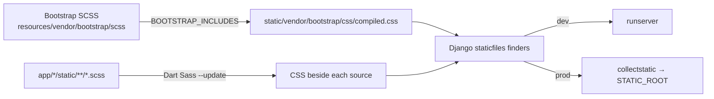

<div align="center">

# 🎨 `djangx.contrib.sass`

**Dart Sass + Bootstrap for djangX. Zero config, instant rebuilds.**

`SCSS in` → `CSS out` → `served by Django staticfiles`

</div>

---

## ✨ What it handles

### 🅱️ Bootstrap

- [x] Compiles the **vendored Bootstrap SCSS** to a single `compiled.css`
- [x] Picks only the components you ask for via `BOOTSTRAP_INCLUDES`
- [x] Always includes `root`, `helpers` and `utilities/api`
- [x] Supports the full bundle with `"__all__"`
- [x] Can be switched off completely with `None` (and cleans up old output)
- [x] Fails the build on unknown component names
- [x] Rebuilds **only** when its own fingerprint changes or its output is missing
- [x] Keeps the Bootstrap SCSS on the project's Sass load path, even when Bootstrap is off

### 📄 Your project Sass

- [x] Discovers `.scss` / `.sass` files recursively in each project app's `static/` folder
- [x] Writes CSS **beside the source** (`site.scss` → `site.css`)
- [x] Skips partials (`_name.scss`) as standalone outputs, but still allows them in imports
- [x] Builds incrementally with Dart Sass `--update` when settings are unchanged
- [x] Forces a full rebuild when `SASS_DART_OPTIONS`, the executable or the djangX version changes

### 🔥 Development experience

- [x] `runserver` builds Sass before the server starts
- [x] Template tags compile a stale or missing CSS file on first use (`DEBUG=True`)
- [x] A background watcher polls Sass folders every 0.5 s, **partials included**
- [x] Compile errors are printed without crashing the dev server
- [x] `django-browser-reload` only fires after the CSS is rebuilt, not on the `.scss` edit

### 🚀 Production

- [x] `djx collectstatic` builds Sass first, then collects
- [x] `.scss`, `.sass` and both build stamps are excluded from `STATIC_ROOT`
- [x] No surprise downloads: Sass is **not** auto-installed during collectstatic
- [x] With `DEBUG=False` the template tags only emit static URLs

### 🛡️ Safety nets

- [x] System check `djangx.core.E001` errors if `BOOTSTRAP_INCLUDES`, `SASS_DART_OPTIONS` or `SASS_EXECUTABLE` is set but `djangx.contrib.sass` is not in `INSTALLED_APPS`
- [x] Clear `SassCompilerError` messages when Sass or npm can't be found or run

---

## ⚡ Quick start

```python
# settings.py (generated by `djangx startproject`)
INSTALLED_APPS = [..., "djangx.contrib.sass"]

BOOTSTRAP_INCLUDES = ["content", "layout", "forms", "buttons"]
SASS_DART_OPTIONS = {"style": "compressed", "source_map": True}
```

```django



```

```text
app/blog/static/blog/css/site.scss   ← you write this
app/blog/static/blog/css/site.css    ← generated, served as /static/blog/css/site.css
```

```bash
djx runserver        # builds, serves, watches
```

---

## 📦 Requirements

- Python **3.14+** and Django **6.1+**
- `nodeenv` (installed with djangX) so Sass can be installed without a system-wide Node
- `django-browser-reload` (installed with djangX) for live reload in development
- An **active virtual environment** if you want djangX to install Sass for you

No separate Node or npm setup is needed. `djx sass --install` creates a Node environment inside your venv and installs `sass-embedded` there.

---

## 🗺️ How it flows



### Sources and outputs

| | Source | Compiled output | Static path |
| --- | --- | --- | --- |
| **Bootstrap** | `djangx.contrib.sass/resources/vendor/bootstrap/scss/` | `djangx.contrib.sass/static/vendor/bootstrap/css/compiled.css` | `vendor/bootstrap/css/compiled.css` |
| **Project** | `app/<name>/static/<path>.scss` or `.sass` | Beside the source as `<path>.css` | Same path, `.css` extension |

Example: `app/blog/static/blog/css/site.scss` → `app/blog/static/blog/css/site.css` → `static/blog/css/site.css`.

> **Discovery rules:** only installed Django apps whose names start with `app.` are scanned, recursively under their `static/` folder. djangX auto-installs every folder in `app/` that contains an `apps.py` (as `app.<folder>`), so a folder **without `apps.py` is not an app and its Sass is ignored**. `STATICFILES_DIRS` is **not** scanned for Sass.

Both outputs live in normal app `static/` folders, so Django's standard finders serve and collect them. No custom finder is needed.

---

## ⚙️ Settings

| Setting | Default (generated) | Purpose |
| --- | --- | --- |
| `BOOTSTRAP_INCLUDES` | `["content", "layout", "forms", "buttons"]` | Which Bootstrap parts to compile |
| `SASS_DART_OPTIONS` | `{"style": "compressed", "source_map": True}` | Passed to the Dart Sass CLI |
| `SASS_EXECUTABLE` | `None` | Path to a specific Sass executable |

### `BOOTSTRAP_INCLUDES`

| Value | Result |
| --- | --- |
| `None` | Bootstrap **off**. `bootstrap_css` renders nothing and old output is removed |
| `[]` | Base only: `root` + `helpers` + `utilities/api` |
| `["card", "nav", ...]` | Base + the listed components, in Bootstrap's canonical order |
| `"__all__"` | The complete Bootstrap entry point |
| Unknown name | ❌ Build fails with `Unknown BOOTSTRAP_INCLUDES: ...` |

<details>
<summary><b>Supported components</b></summary>

`content` · `layout` · `forms` · `buttons` · `accordion` · `alert` · `avatar` · `badge` · `breadcrumb` · `chip` · `card` · `carousel` · `datepicker` · `dialog` · `menu` · `list-group` · `nav` · `nav-overflow` · `navbar` · `drawer` · `pagination` · `placeholder` · `popover` · `progress` · `spinner` · `stepper` · `toasts` · `tooltip` · `transitions`

</details>

### `SASS_DART_OPTIONS`

Keys map to Dart Sass CLI flags: underscores become hyphens.

| Python | CLI |
| --- | --- |
| `"style": "compressed"` | `--style=compressed` |
| `"source_map": True` | `--source-map` |
| `"source_map": False` | `--no-source-map` |
| `"load_paths": [a, b]` | `--load-path=a --load-path=b` |

Source maps are **off** unless you turn them on.

### `SASS_EXECUTABLE`

Resolution order: `--sass-executable PATH` / `SASS_EXECUTABLE` → the virtualenv's Node environment → `PATH`. If none is found, the build either auto-installs (see below) or raises an error that says how to fix it.

---

## 🧰 Commands

| Command | What it does |
| --- | --- |
| `djx sass --build` | Rebuild Bootstrap (if enabled) and all project Sass |
| `djx sass --build --if-changed` | Rebuild only what's stale (what `runserver` uses) |
| `djx sass --install` | Install `sass-embedded` into the venv's Node environment |
| `djx sass --build --no-install` | Build, but never auto-install Sass |
| `djx sass --build --sass-executable PATH` | Use a specific Sass binary |
| `djx collectstatic` | Build Sass, then collect (no confirmation prompt) |
| `djx collectstatic --install-sass` | Install Sass first if it's missing |
| `djx collectstatic --no-sass` | Skip the Sass build |
| `djx collectstatic --interactive` | Ask before overwriting, like stock Django |

`djx collectstatic --dry-run` skips the Sass build.

> **Auto-install:** `djx sass --build` and `runserver` install `sass-embedded` automatically if Sass is missing. This needs an **active virtual environment**. `collectstatic` never auto-installs unless you pass `--install-sass`, so deploys don't download Node mid-build.

### What triggers a rebuild?

| Change | Bootstrap | Project Sass |
| --- | :---: | :---: |
| Edit a `.scss` / `.sass` file | – | ✅ (`--update`, stale files only) |
| `BOOTSTRAP_INCLUDES` | ✅ | – |
| `SASS_DART_OPTIONS` | ✅ | ✅ full |
| `SASS_EXECUTABLE` / `--sass-executable` | ✅ | ✅ full |
| djangX version | ✅ | ✅ full |
| Bootstrap `compiled.css` missing | ✅ | – |

Fingerprints are stored as stamp files: `.settings-hash` beside the Bootstrap CSS and `.sass-settings-hash` in the Sass app's `static/` folder. Both are excluded from `collectstatic`.

---

## 🔥 Development flow

1. **`runserver`** runs `sass --build --if-changed` first, compiling every discovered app Sass folder.
2. **Template tags** (`sass_url` / `sass_css`) do a one-time freshness check per CSS path. If the CSS is missing or older than its source, they trigger an incremental build. They then **register that folder with the watcher**.
3. **`SassWatcher`** (one daemon thread) polls registered folders every 0.5 s. Any change, partials included, triggers `sass --build --if-changed`.
4. **Browser reload** (djangX adds `django-browser-reload` to your apps and middleware automatically when `DEBUG=True`): `.scss` / `.sass` events are swallowed so the page doesn't reload before compilation finishes. The generated CSS change is forwarded normally.

If a build fails, the error is printed as `Sass compile failed: ...`. The watcher retries after your **next edit**, not on every poll.

### Template tags

| Tag | Output |
| --- | --- |
| `` | Static URL of the compiled Bootstrap CSS, or `""` if off |
| `` | `<link>` tag for it, or `""` if off |
| `` | Static URL of one of your compiled files |
| `` | `<link>` tag wrapper around `sass_url` |

Always refer to the **`.css`** path relative to the app's `static/` folder.

---

## 🚢 Production checklist

- [ ] `djx sass --install` (or set `SASS_EXECUTABLE`) in your build environment
- [ ] `djx collectstatic` (builds Sass, then collects)
- [ ] `DEBUG=False`, so tags only produce static URLs and never compile

---

## 🧩 Module map

| Module | Responsibility |
| --- | --- |
| `utils.Sass` | Find/install Sass, build CLI flags, compile source text |
| `utils.SassStatic` | Discover app static folders, map CSS → source, compile beside sources |
| `utils.SassBootstrap` | Bootstrap paths, component list, entry SCSS generation, compilation |
| `utils.SassWatcher` | Poll folders, rebuild on change, wire up browser reload |
| `management/commands/sass` | `djx sass`: fingerprints, install, build orchestration |
| `management/commands/runserver` | Build before serving |
| `management/commands/collectstatic` | Build before collecting; exclude sources and stamps |
| `templatetags/sass` | `bootstrap_css*`, `sass_url`, `sass_css` |
| `types.BootstrapIncludesType` | `list[str] \| Literal["__all__"] \| None` |

---

## ⚠️ Good to know

- Bootstrap CSS is written **inside the installed Sass app's `static/` folder**, so that location must be writable.
- Partials (`_*.scss`) never produce their own CSS.
- The Bootstrap SCSS directory is always a load path for your Sass, even with `BOOTSTRAP_INCLUDES = None`, so your `@use`/`@import` behavior doesn't change when you toggle Bootstrap.
- `BOOTSTRAP_INCLUDES = []` is **not** the same as `None`: `[]` still builds the base, helpers and utilities.