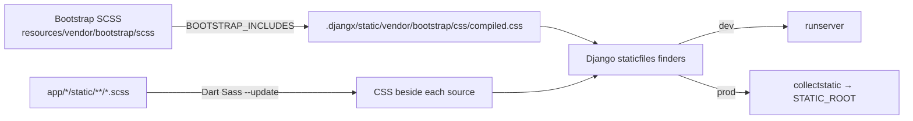

<!-- ramani: src/djangx/contrib/sass/README.md -->
<div align="center">

# 🎨 `djangx.contrib.sass`

**Dart Sass + Bootstrap for djangX. Zero config, instant rebuilds.**

`SCSS in` → `CSS out` → `served by Django staticfiles`

</div>

---

## ✨ What it handles

### 🅱️ Bootstrap

- [x] Compiles the **vendored Bootstrap SCSS** to a single `compiled.css` in your project's `.djangx/static/`, never inside the installed package
- [x] Picks only the components you ask for via `BOOTSTRAP_INCLUDES`
- [x] Always includes `root`, `helpers` and `utilities/api`
- [x] Supports the full bundle with `"__all__"`
- [x] Can be switched off completely with `None` (and cleans up old output)
- [x] Fails the build on unknown component names
- [x] Rebuilds **only** when its own fingerprint changes or its output is missing
- [x] Keeps the Bootstrap SCSS on the project's Sass load path, even when Bootstrap is off

### 📄 Your project Sass

- [x] Discovers `.scss` / `.sass` files recursively in each project app's `static/` folder
- [x] Writes CSS **beside the source** (`site.scss` → `site.css`)
- [x] Skips partials (`_name.scss`) as standalone outputs, but still allows them in imports
- [x] Builds incrementally with Dart Sass `--update` when settings are unchanged
- [x] Forces a full rebuild when `SASS_DART_OPTIONS`, the Sass executable, the Sass version or the djangX version changes
- [x] Keeps generated CSS out of git with a managed block in each Sass folder's `.gitignore` (opt-out)

### 🔥 Development experience

- [x] `runserver` builds Sass before the server starts
- [x] Template tags compile a stale or missing CSS file on first use (`DEBUG=True`)
- [x] A background watcher polls Sass folders every 0.5 s, **partials included**
- [x] Compile errors are printed without crashing the dev server
- [x] `django-browser-reload` only fires after the CSS is rebuilt, not on the `.scss` edit

### 🚀 Production

- [x] `djx collectstatic` builds Sass first, then collects
- [x] `.scss`, `.sass` and `.gitignore` files are excluded from `STATIC_ROOT`
- [x] Build output lives outside `STATIC_ROOT`, so `collectstatic` (even with `--clear`) never copies a file onto itself or deletes the compiled CSS
- [x] Never downloads or installs anything: Sass is a prerequisite you provide
- [x] With `DEBUG=False` the template tags only emit static URLs

### 🛡️ Safety nets

- [x] System check `djangx.core.E001` errors if `BOOTSTRAP_INCLUDES`, `SASS_DART_OPTIONS`, `SASS_EXECUTABLE` or `SASS_GITIGNORE` is set but `djangx.contrib.sass` is not in `INSTALLED_APPS`
- [x] Clear `SassCompilerError` messages when Sass can't be found or run, with a pointer to installing it

---

## ⚡ Quick start

Install [Dart Sass](https://sass-lang.com/install) so the `sass` command is on your `PATH`. Any installation method works.

```python
# settings.py (generated by `djangx startproject`)
INSTALLED_APPS = [..., "djangx.contrib.sass"]

BOOTSTRAP_INCLUDES = ["content", "layout", "forms", "buttons"]
SASS_DART_OPTIONS = {"style": "compressed", "source_map": True}

# Lets Django serve and collect the compiled Bootstrap CSS from `.djangx/static`.
STATICFILES_DIRS = Conf.staticfiles_dirs(base_dir=BASE_DIR)
```

```django



```

```text
app/blog/static/blog/css/site.scss   ← you write this
app/blog/static/blog/css/site.css    ← generated, served as /static/blog/css/site.css
```

```bash
djx runserver        # builds, serves, watches
```

---

## 📦 Requirements

- Python **3.14+** and Django **6.1+**
- **Dart Sass**, installed any way you like, so that the `sass` command is available ([install options](https://sass-lang.com/install))
- `django-browser-reload` (installed with djangX) for live reload in development

djangX never installs Sass for you. It uses the `sass` command on your `PATH`, or the executable named by `SASS_EXECUTABLE`. Existing projects need one settings change: add the `STATICFILES_DIRS` line from the quick start.

---

## 🗺️ How it flows



### Sources and outputs

|               | Source                                                 | Compiled output                                                      | Static path                         |
| ------------- | ------------------------------------------------------ | -------------------------------------------------------------------- | ----------------------------------- |
| **Bootstrap** | `djangx.contrib.sass/resources/vendor/bootstrap/scss/` | `.djangx/static/vendor/bootstrap/css/compiled.css` (in your project) | `vendor/bootstrap/css/compiled.css` |
| **Project**   | `app/<name>/static/<path>.scss` or `.sass`             | Beside the source as `<path>.css`                                    | Same path, `.css` extension         |

Example: `app/blog/static/blog/css/site.scss` → `app/blog/static/blog/css/site.css` → `static/blog/css/site.css`.

> **Discovery rules:** only installed Django apps whose names start with `app.` are scanned, recursively under their `static/` folder. djangX auto-installs every folder in `app/` that contains an `apps.py` (as `app.<folder>`), so a folder **without `apps.py` is not an app and its Sass is ignored**. `STATICFILES_DIRS` is **not** scanned for Sass.

Both outputs live in ordinary static folders: Bootstrap's in `.djangx/static` (listed in `STATICFILES_DIRS`) and yours beside their sources. Django's standard finders serve and collect them, so no custom finder is needed.

---

## ⚙️ Settings

| Setting              | Default (generated)                           | Purpose                                         |
| -------------------- | --------------------------------------------- | ----------------------------------------------- |
| `BOOTSTRAP_INCLUDES` | `["content", "layout", "forms", "buttons"]`   | Which Bootstrap parts to compile                |
| `SASS_DART_OPTIONS`  | `{"style": "compressed", "source_map": True}` | Passed to the Dart Sass CLI                     |
| `SASS_EXECUTABLE`    | `None`                                        | Path to a specific Sass executable              |
| `SASS_GITIGNORE`     | `True` (optional, not generated)              | Maintain `.gitignore` entries for generated CSS |

### `BOOTSTRAP_INCLUDES`

| Value                  | Result                                                                       |
| ---------------------- | ---------------------------------------------------------------------------- |
| `None`                 | Bootstrap **off**. `bootstrap_css` renders nothing and old output is removed |
| `[]`                   | Base only: `root` + `helpers` + `utilities/api`                              |
| `["card", "nav", ...]` | Base + the listed components, in Bootstrap's canonical order                 |
| `"__all__"`            | The complete Bootstrap entry point                                           |
| Unknown name           | ❌ Build fails with `Unknown BOOTSTRAP_INCLUDES: ...`                        |

<details>
<summary><b>Supported components</b></summary>

`content` · `layout` · `forms` · `buttons` · `accordion` · `alert` · `avatar` · `badge` · `breadcrumb` · `chip` · `card` · `carousel` · `datepicker` · `dialog` · `menu` · `list-group` · `nav` · `nav-overflow` · `navbar` · `drawer` · `pagination` · `placeholder` · `popover` · `progress` · `spinner` · `stepper` · `toasts` · `tooltip` · `transitions`

</details>

### `SASS_DART_OPTIONS`

Keys map to Dart Sass CLI flags: underscores become hyphens.

| Python                  | CLI                           |
| ----------------------- | ----------------------------- |
| `"style": "compressed"` | `--style=compressed`          |
| `"source_map": True`    | `--source-map`                |
| `"source_map": False`   | `--no-source-map`             |
| `"load_paths": [a, b]`  | `--load-path=a --load-path=b` |

Source maps are **off** unless you turn them on.

### `SASS_EXECUTABLE`

Resolution order: `--sass-executable PATH` / `SASS_EXECUTABLE` → the `sass` command on `PATH`. If neither is found, the build stops with an error that points to the install instructions.

### `SASS_GITIGNORE`

Compiled CSS sits beside its source, so each Sass static folder gets a `.gitignore` with a block djangX manages:

```gitignore
# my own rules stay untouched
*.log

# >>> djangx sass: generated CSS (managed automatically, do not edit) >>>
/blog/css/site.css
/blog/css/site.css.map
# <<< djangx sass <<<
```

- Entries are **exact files**, never `*.css`, so hand-written CSS is not ignored.
- Partials (`_*.scss`) produce no CSS, so they are not listed.
- The block is rewritten on every build, so added and removed sources are picked up. Lines outside the markers are never touched, and the file's line endings are preserved.
- A file with a start marker but no end marker is left alone.
- Set `SASS_GITIGNORE = False` if you commit compiled CSS on purpose.
- Git can't untrack files it already tracks. If you committed generated CSS earlier, run `git rm --cached <file>` once.

---

## 🧰 Commands

| Command                                   | What it does                                        |
| ----------------------------------------- | --------------------------------------------------- |
| `djx sass --build`                        | Rebuild Bootstrap (if enabled) and all project Sass |
| `djx sass --build --if-changed`           | Rebuild only what's stale (what `runserver` uses)   |
| `djx sass --build --sass-executable PATH` | Use a specific Sass binary                          |
| `djx collectstatic`                       | Build Sass, then collect (no confirmation prompt)   |
| `djx collectstatic --no-sass`             | Skip the Sass build                                 |
| `djx collectstatic --interactive`         | Ask before overwriting, like stock Django           |

`djx collectstatic --dry-run` skips the Sass build.

### What triggers a rebuild?

| Change                                    | Bootstrap |           Project Sass            |
| ----------------------------------------- | :-------: | :-------------------------------: |
| Edit a `.scss` / `.sass` file             |     –     | ✅ (`--update`, stale files only) |
| `BOOTSTRAP_INCLUDES`                      |    ✅     |                 –                 |
| `SASS_DART_OPTIONS`                       |    ✅     |              ✅ full              |
| `SASS_EXECUTABLE` / `--sass-executable`   |    ✅     |              ✅ full              |
| djangX version                            |    ✅     |              ✅ full              |
| Installed Sass version (`sass --version`) |    ✅     |              ✅ full              |
| Bootstrap `compiled.css` missing          |    ✅     |                 –                 |

Fingerprints are stored as stamp files in `.djangx/sass/` (`bootstrap.hash` and `project.hash`), outside any static folder, so they are never collected.

---

## 🔥 Development flow

1. **`runserver`** runs `sass --build --if-changed` first, compiling every discovered app Sass folder.
2. **Template tags** (`sass_url` / `sass_css`) do a one-time freshness check per CSS path. If the CSS is missing or older than its source, they trigger an incremental build. They then **register that folder with the watcher**.
3. **`SassWatcher`** (one daemon thread) polls registered folders every 0.5 s, using a single directory walk per folder. Any change, partials included, triggers `sass --build --if-changed`.
4. **Browser reload** (djangX adds `django-browser-reload` to your apps and middleware automatically when `DEBUG=True`): `.scss` / `.sass` events are swallowed so the page doesn't reload before compilation finishes. The generated CSS change is forwarded normally.

If a build fails, the error is printed as `Sass compile failed: ...`. The watcher retries after your **next edit**, not on every poll.

### Template tags

| Tag                                  | Output                                                   |
| ------------------------------------ | -------------------------------------------------------- |
| ``            | Static URL of the compiled Bootstrap CSS, or `""` if off |
| ``                | `<link>` tag for it, or `""` if off                      |
| `` | Static URL of one of your compiled files                 |
| `` | `<link>` tag wrapper around `sass_url`                   |

Always refer to the **`.css`** path relative to the app's `static/` folder.

---

## 🚢 Production checklist

- [ ] Dart Sass available in your build environment (`sass` on `PATH`), or `SASS_EXECUTABLE` set
- [ ] `djx collectstatic` (builds Sass, then collects)
- [ ] `DEBUG=False`, so tags only produce static URLs and never compile

---

## 🗂️ The `.djangx` folder

djangX keeps generated, never-committed files in `BASE_DIR/.djangx`. It is created automatically, together with `static/` and a `.gitignore` containing `*`. If that `.gitignore` already exists, djangX leaves it alone.

| Path              | Contents                                                                                                             |
| ----------------- | -------------------------------------------------------------------------------------------------------------------- |
| `.djangx/static/` | Generated static files, such as `vendor/bootstrap/css/compiled.css`. Served and collected through `STATICFILES_DIRS` |
| `.djangx/sass/`   | Build fingerprints (`bootstrap.hash`, `project.hash`)                                                                |

The folder is general-purpose: other djangX features can use their own subfolders, and the Sass app only uses the two above.

---

## 🧩 Module map

| Module                                  | Responsibility                                                             |
| --------------------------------------- | -------------------------------------------------------------------------- |
| `utils.Sass`                            | Find Sass, build CLI flags, compile source text                            |
| `utils.SassStatic`                      | Discover app static folders, map CSS → source, compile beside sources      |
| `utils.SassBootstrap`                   | Bootstrap paths, component list, entry SCSS generation, compilation        |
| `utils.SassGitignore`                   | Maintain the managed `.gitignore` block for generated CSS                  |
| `utils.SassWatcher`                     | Poll folders, rebuild on change, wire up browser reload                    |
| `management/commands/sass`              | `djx sass`: fingerprints and build orchestration                           |
| `management/commands/runserver`         | Build before serving                                                       |
| `management/commands/collectstatic`     | Build before collecting; exclude Sass sources and `.gitignore` files       |
| `core.utils.djangx_dir.DjangxDir`       | Locate and create the project's `.djangx` folder (with a `*` `.gitignore`) |
| `core.utils.conf.Conf.staticfiles_dirs` | Add `.djangx/static` to `STATICFILES_DIRS`                                 |
| `templatetags/sass`                     | `bootstrap_css*`, `sass_url`, `sass_css`                                   |
| `types.BootstrapIncludesType`           | `list[str] \| Literal["__all__"] \| None`                                  |

---

## ⚠️ Good to know

- Bootstrap CSS is written to **your project's** `.djangx` folder, never to the installed package, so projects sharing a virtual environment don't collide and read-only installs work.
- Upgrading from an earlier version? Add the `STATICFILES_DIRS` line, make sure Dart Sass is installed, then run `djx sass --build`. Any old `compiled.css`, `.settings-hash` or `.sass-settings-hash` inside the package's `static/` folder can be deleted, and so can `.djangx/node` if an earlier version created it.
- Partials (`_*.scss`) never produce their own CSS.
- The Bootstrap SCSS directory is always a load path for your Sass, even with `BOOTSTRAP_INCLUDES = None`, so your `@use`/`@import` behavior doesn't change when you toggle Bootstrap.
- `BOOTSTRAP_INCLUDES = []` is **not** the same as `None`: `[]` still builds the base, helpers and utilities.
